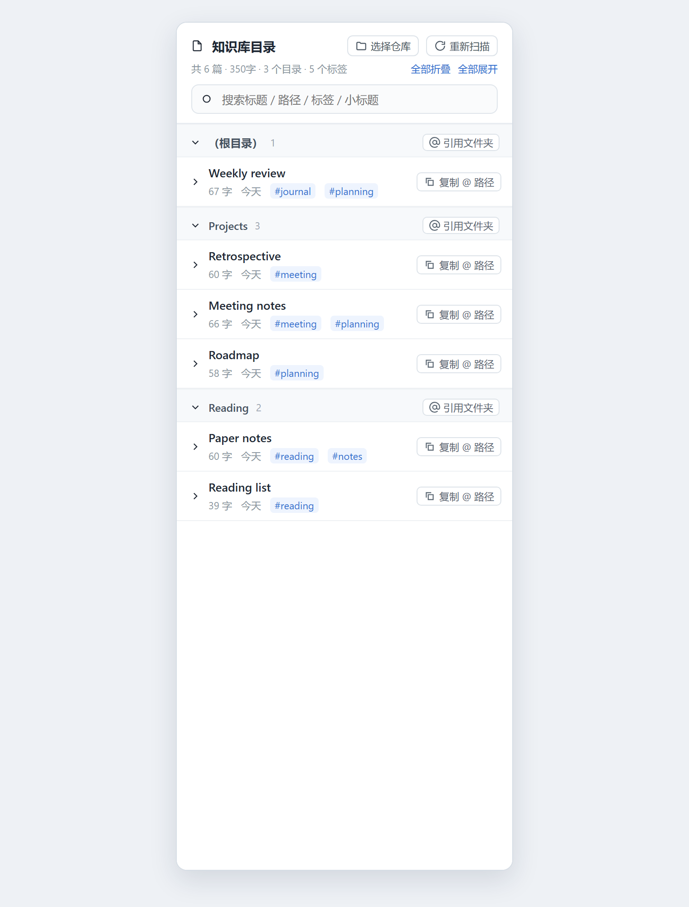
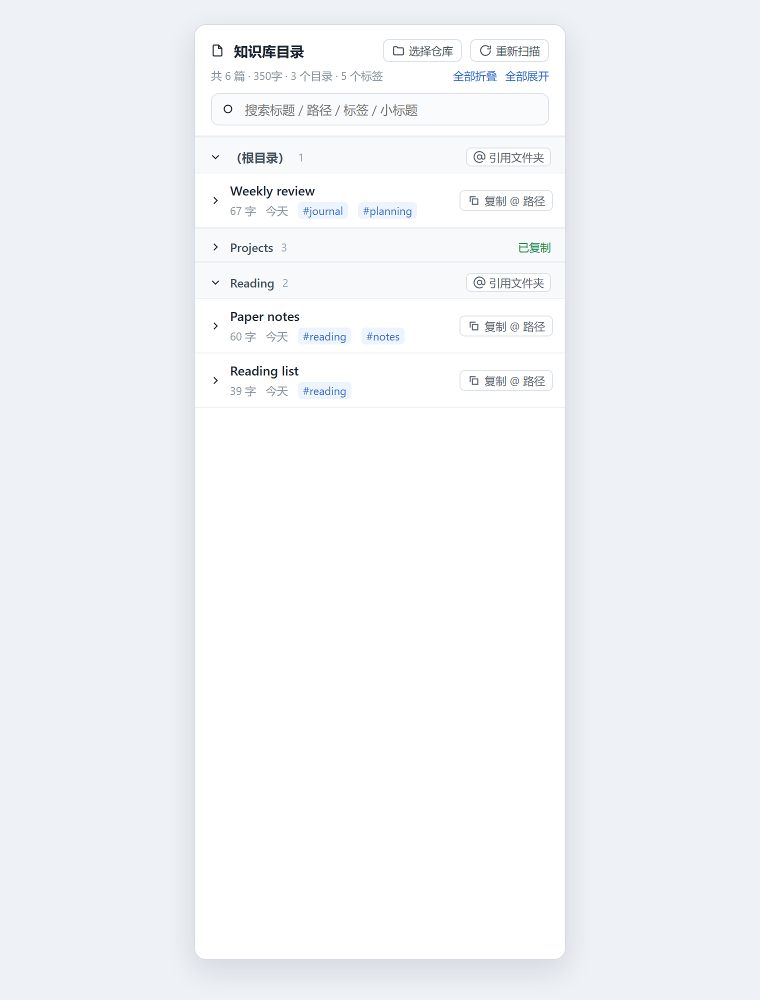
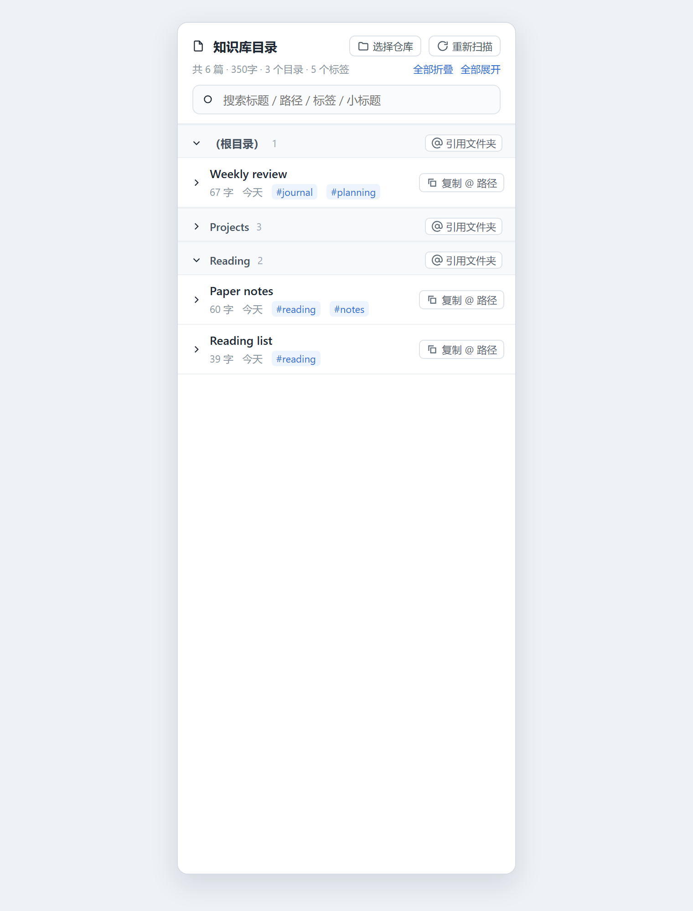
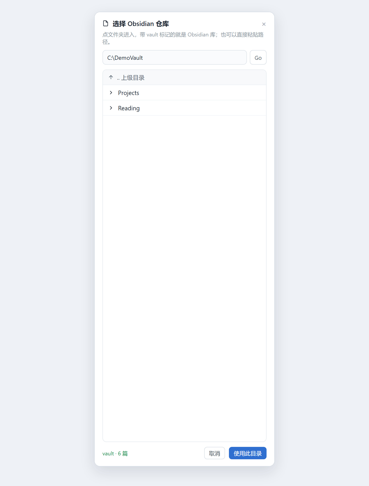

# Obsidian Catalog · 知识库目录

A DeepSeek Harness bundle that renders an Obsidian vault as a live table of contents inside a conversation view.

The panel reads the vault directory straight off disk on the host side and shows it grouped by folder: note titles, word counts, relative dates, tags, and a collapsible outline of each note's headings. Every note row and folder row has a one-click `@absolute\path` copy button, so the note can be referenced in the chat box without typing the path by hand. The vault itself is chosen from inside the panel, so a second vault does not need a second install.



## What it does

- **Live folder tree** — groups follow the vault's directory structure, with a note count per group. Each group and each note collapses independently; two header buttons collapse or expand everything at once.
- **Search** — filters across title, full path, tags and heading text. Search temporarily expands every match.
- **Per-note stats** — CJK-character plus Latin-word count, relative modification date, and frontmatter tags read from the vault.
- **Heading outline** — the first three heading levels of each note, indented by level, with the leading `#` stripped. A heading identical to the note title is skipped.
- **`@` path copying** — `复制 @ 路径` on a note row copies `@D:\Notes\MyVault\folder\note.md`; `@ 引用文件夹` on a folder row copies `@D:\Notes\MyVault\folder` (the vault root copies `@D:\Notes\MyVault`). Both flash a confirmation in place.
- **Vault switching** — `选择仓库` opens a directory browser: paste a path and press `Go`, walk up with `.. 上级`, or pick a drive. Directories that look like a vault (contain a `.obsidian` folder) are marked; `使用此目录` switches the panel to that vault and remembers the choice.
- **Refresh** — rescans on demand, and polls every 15 seconds. Unchanged notes are served from a `mtime + size` cache.





## Install

```sh
dsh plugin --profile web add dsh-plugin-obsidian-catalog
```

Restart DeepSeek Harness if the plugin does not appear, then open a session and pick
**知识库目录 / Obsidian Catalog** from the conversation view switcher.

To install straight from a checkout instead of npm:

```text
plugin_manager { action: "install_bundle", target: "<absolute path to this repository>" }
```

Requires DeepSeek Harness 0.2.x.

## Configuration

The vault is resolved in this order:

1. `~/.dsh/obsidian-catalog.json` — written by `使用此目录`, shaped `{ "vault": "D:\\Notes\\MyVault" }`
2. the `DSH_OBSIDIAN_VAULT` environment variable
3. `<home>\obsidian` as a fallback

Deleting the config file returns the panel to the fallback.

## HTTP routes

The bundle registers three routes on the host `webServer` service. All are read-only except the vault switch, and all are scoped to markdown files inside the selected vault.

| Method and path | Purpose |
| --- | --- |
| `GET /api/obsidian-catalog` | Snapshot of the selected vault: notes, tags, headings, word counts |
| `GET /api/obsidian-catalog/dirs?path=` | Directory browsing: an empty `path` lists drives, otherwise subdirectories plus whether each one is a vault |
| `POST /api/obsidian-catalog/vault` | `{ "path": "D:\\Notes\\MyVault" }` — validates the directory, scans it, then persists the choice |

## Layout

| File | Purpose |
| --- | --- |
| `index.js` | Host side: registers the three routes, scans the vault, caches by `mtime + size` |
| `client.js` | Client side: `window.__ModuleLoader__.load(...)`, registers the `obsidian-catalog` view on `conversation.view` |
| `cordis.patch.yml` | `- insert: [{ id: obsidian-catalog, name: dsh-plugin-obsidian-catalog }]` |
| `locale/*.json` | Chinese and English title and description |
| `screenshots.json` | Storefront screenshots, relative to this file |

The panel uses only `--dsw-alias-*` theme tokens, so it follows the active light or dark theme.

## Notes

- The panel is read-only with respect to the vault: it stats and reads files, and never writes to them.
- Word counts use the same rule as the companion Obsidian plugin: CJK characters plus Latin words (`[A-Za-z][A-Za-z0-9'’\-]*`).
- Scan limits: at most 12 directory levels and 5000 markdown files per scan.
- Every screenshot on this page was rendered from a synthetic six-note demo vault; no real notes, paths or account names appear in them.

## License

MIT
